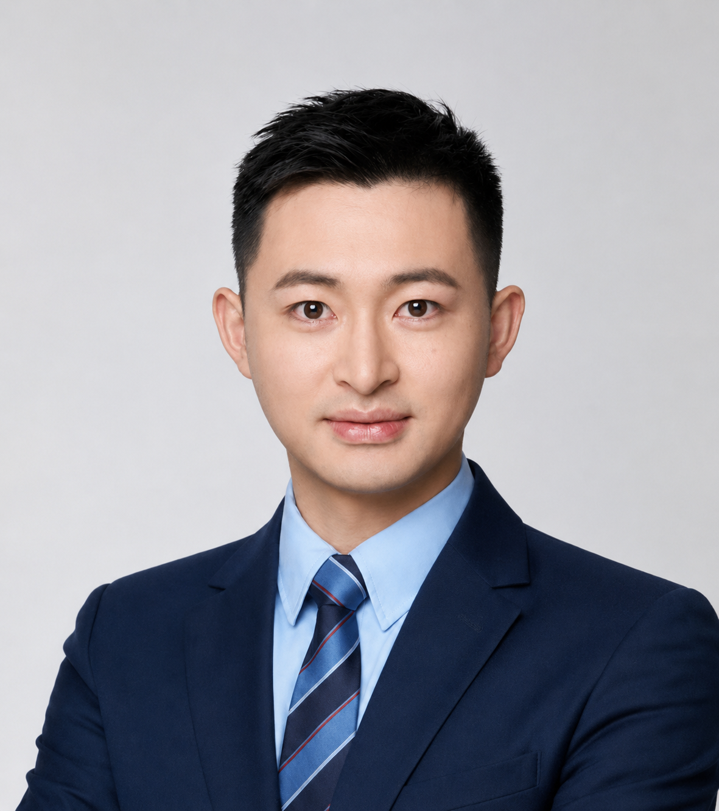
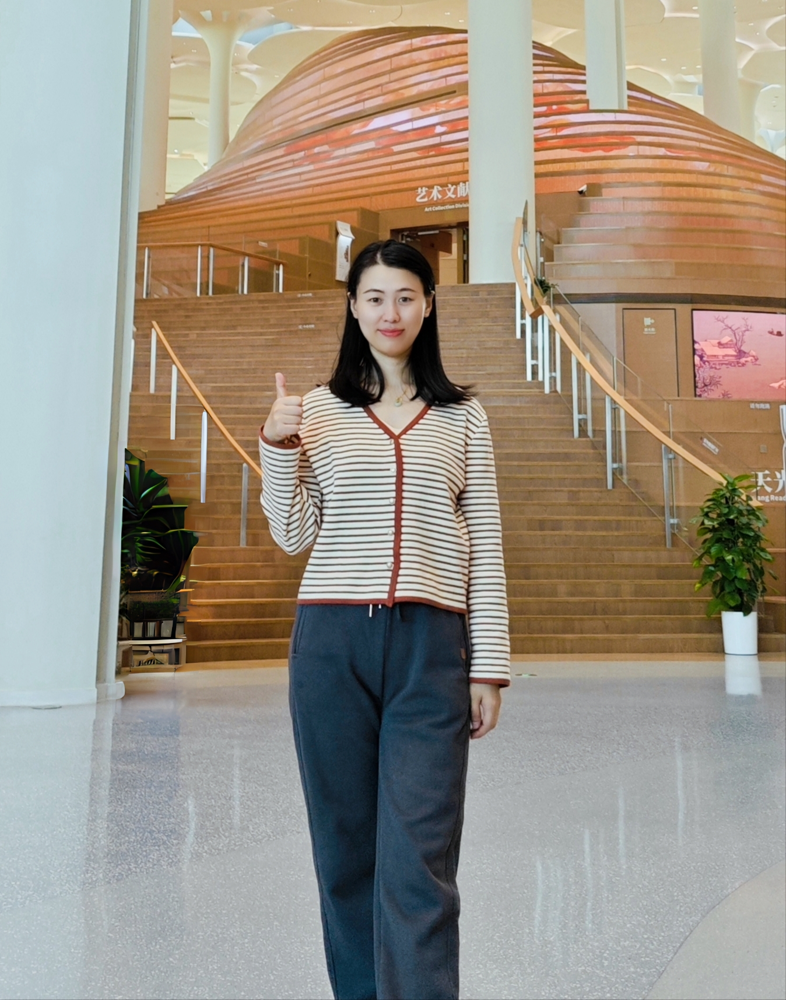
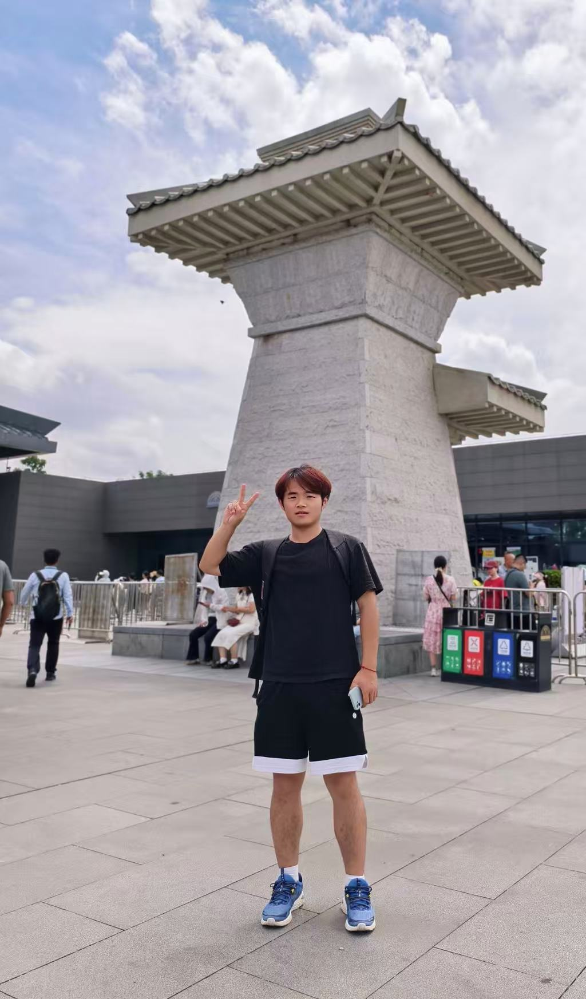

## Principal Investigator

:::::: team-grid
::: team-photo
{width="220px"}
:::

::::: team-info
::: team-background
### Chang Li
- **2027 – Present**: Assistant Professor, Westlake University
- **2024 – 2026**: Postdoc, Lawrence Berkeley National Laboratory
- **2019 – 2024**: Ph.D. in Chemistry, University of Waterloo
- **2015 – 2019**: B.Eng. in Materials Science and Engineering, Huazhong University of Science and Technology
:::

::: team-links
### Links
::: link-row
📧 [lichang@westlake.edu.cn](mailto:lichang@westlake.edu.cn){.email}
📚 [Google Scholar](https://scholar.google.com/citations?user=nvmiWvoAAAAJ&hl=en)
<a href="https://orcid.org/0000-0001-5420-3856">  ORCID </a>
🏫 [Westlake](https://en.westlake.edu.cn/faculty/chang-li.html)
:::
:::

:::::

::::::

## Administrative Assistant

:::::: team-grid

::: team-photo
{width="220px"}
:::

::::: team-info

::: team-background

### Lili Pan

- **Joined**: Aug 2026
- **Education**: 
  - M.Eng. in Industrial Catalysis (2020, Tianjin University)
  - B.Eng. in Chemical Engineering and Technology (2017, China University of Petroleum, Beijing)
- **Research Interests**: 
  - Water electrolysis

:::

::: team-links

### Links
::: link-row
📧 [panlili@westlake.edu.cn](mailto:panlili@westlake.edu.cn){.email}

:::

:::

:::::

::::::

## Postdocs

:::::: team-grid

::: team-photo
{width="220px"}
:::

::::: team-info

::: team-background

### XXX XX  

- **Joined**: Jan 2027 (Postdoc)
- **Education**: 
  - Ph.D. in XXX
  - M.S. in XXX
  - B.S. in XXX
- **Research Interests**: 
  - XXX
  - XXX
:::

::: team-links
### Links
::: link-row
📧 [xxx@westlake.edu.cn](mailto:xxx@westlake.edu.cn){.email}
:::
:::

:::::

::::::

## PhD Students

:::::: team-grid

::: team-photo
{width="220px"}
:::

::::: team-info

::: team-background
### Hongyan Ma
- **Joined**: Nov 2026 (Ph.D. student)
- **Education**: 
  - Ph.D. student (2025-present, Westlake University) 
  - B.Eng. in Chemical Engineering and Technology (2025, Harbin Institute of Technology, Weihai)
- **Research Interests**: 
  - Control electrode-electrolyte interfaces in multivalent metal batteries
  - Design cathode materials for multivalent metal batteries
:::

::: team-links
### Links
::: link-row
📧 [mahongyan@westlake.edu.cn](mailto:mahongyan@westlake.edu.cn){.email}
:::
:::

:::::

::::::

## Research Assistants

:::::: team-grid

::: team-photo
{width="220px"}
:::

::::: team-info

::: team-background
### Ziao Wang
- **Joined**: Nov 2026 (RA)
- **Education**: 
  - Ph.D. student (2024-2025, University of California, Riverside) 
  - B.Eng. in Environmental Engineering (2024, Lübeck University of Applied Sciences)
  - B.Eng. in Chemical Engineering and Technology (2024, East China University of Science and Technology)
- **Research Interests**: 
  - Design membranless electrochemical carbon capture 
  - Develop high-throughput characterization techniques
:::

::: team-links
### Links
::: link-row
📧 [xxx@westlake.edu.cn](mailto:xxx@westlake.edu.cn){.email}
:::
:::

:::::

::::::

:::::: team-grid

::: team-photo
{width="220px"}
:::

::::: team-info

::: team-background
### XXX XXX
- **Joined**: Jan 2027 (RA); Aug 2027 (Ph.D. student)
- **Education**: 
  - MRes in XXX 
  - B.S. in XXX
- **Research Interests**: 
  - XXX 
  - XXX
:::

::: team-links
### Links
::: link-row
📧 [xxx@westlake.edu.cn](mailto:xxx@westlake.edu.cn){.email}
:::
:::

:::::

::::::
