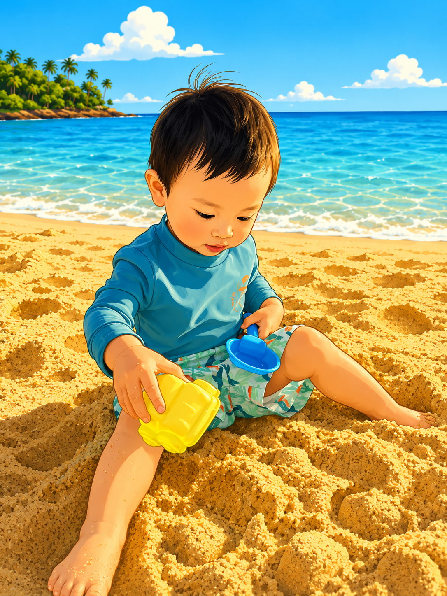

## Principal Investigator

:::::: team-grid

:::: team-photo
{width="220px"}

::: team-links

::: link-row
📧 [lichang@westlake.edu.cn](mailto:lichang@westlake.edu.cn){.email}
📚 [Google Scholar](https://scholar.google.com/citations?user=nvmiWvoAAAAJ&hl=en)

<a href="https://orcid.org/0000-0001-5420-3856">

ORCID
</a>

🏫 [Westlake](https://en.westlake.edu.cn/faculty/chang-li.html)
:::

:::
::::

::::: team-info

::: team-background

### Chang Li

Prof. Chang Li is a tenure-track Assistant Professor in the School of Engineering at Westlake University. He received his bachelor’s degree in Materials Science and Engineering from Huazhong University of Science and Technology (2015–2019), where he developed a lasting interest in electrochemistry through research in a battery laboratory. He went on to earn his Ph.D. in Chemistry from the University of Waterloo (2019–2024) and subsequently conducted postdoctoral research at Lawrence Berkeley National Laboratory and the University of California, Berkeley (2025–2026).

His research focuses on electrochemical interfaces in energy storage and conversion systems, where ions, electrons, molecules, and materials interact. His group studies these interfacial processes through materials and electrolyte design, operando characterization, and automated experimentation.

:::

:::::

::::::

## Administrative Assistant

:::::: team-grid

::: team-photo
{width="220px"}
:::

::::: team-info

::: team-background

### Lili Pan

- Joined: Aug-2026
- Education: Master of Industrial Catalysis (2020, Tianjin University)
- Research Interests: Water electrolysis
- About Me: like running and swimming

:::

::: team-links

### Links
::: link-row
📧 [panlili@westlake.edu.cn](mailto:panlili@westlake.edu.cn){.email}

:::

:::

:::::

::::::

## Postdocs

:::::: team-grid

::: team-photo
{width="220px"}
:::

::::: team-info

::: team-background

### Alex

- Joined: Jan-2027
- Education: Ph.D. in Traveling (2026, University of Independence)
- Research Interests: Solid state batteries
- About Me: I like eating

:::

::: team-links

### Links
::: link-row
📧 [alex@westlake.edu.cn](mailto:alex@westlake.edu.cn){.email}

:::

:::

:::::

::::::

## PhD Students

:::::: team-grid

::: team-photo
{width="220px"}
:::

::::: team-info

::: team-background

### LYZ

- Joined: Jan-2027 (RA), Aug-2027 (PhD)
- Education: B.Eng. in Exploring (2026, University of Curiosity)
- Research Interests: Mg batteries
- About Me: I like cooking

:::

::: team-links

### Links
::: link-row
📧 [lyz@westlake.edu.cn](mailto:lyz@westlake.edu.cn){.email}

:::

:::

:::::

::::::

## Research Assistants

:::::: team-grid

::: team-photo
{width="220px"}
:::

::::: team-info

::: team-background

### YZ A. Li

- Joined: Jan-2027
- Education: B.Eng. in Jumping (2026, University of Courage)
- Research Interests: Automation
- About Me: I like robots

:::

::: team-links

### Links
::: link-row
📧 [yal@westlake.edu.cn](mailto:yal@westlake.edu.cn){.email}

:::

:::

:::::

::::::